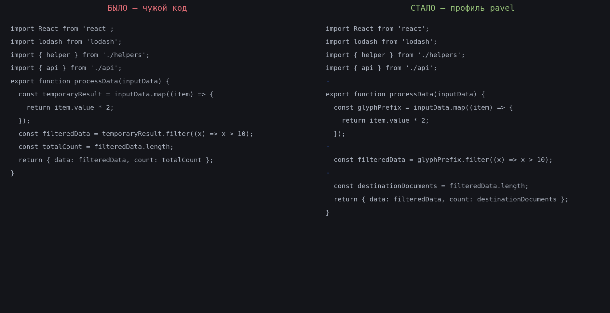

# codeprint

Наложение «фингерпринта автора» на код: система измеряет стиль автора по
git-истории его донейроночного кода, обучает мелкие модели-«решалки» и
переписывает чужой код в этом стиле — детерминированно, безопасно и
воспроизводимо (seed = ключ watermark'а).



## Как это работает

```
git-история автора ──harvest──> датасеты (datasets/<репо>/<дедлайн>/)
                                   │
                        trainer (GB10 / CPU, torch)
                                   │
                        модели-решалки (models/, 3–4M параметров)
                                   │
   чужой код ──composer──> imports → naming → wrapping → blanklines
                                   │
                    syntax-gate (tree-sitter) + токен-инвариант
                                   │
            измерение: bench (восстановление), stylometer (свой/чужой),
                       similarity (winnowing до/после)
```

Нейронка никогда не пишет код — она отвечает на узкие вопросы
(«пустая строка тут?», «переносить строку?»), а применяют решения
детерминированные движки с гейтами безопасности.

## Измеренные результаты (профиль you, репо myrepo)

| Ось / модуль | Метрика | Значение |
|---|---|---|
| blanklines (нейронка 3.5M) | val accuracy / восстановление ритма | **0.928** / **93.7%** (эвристика: 60.2%) |
| wrapping (нейронка 3.6M) | val accuracy | **0.982** (baseline 0.727) |
| imports | профильный (не нейронный) — negative result задокументирован | схемы: flat_asis 64% |
| naming (словарь) | дискриминация соавторов | **0.688** — лучший сигнал |
| stylometer v2 (границы) | свой/чужой среди коллег | 0.616 — слабо (prettier стирает стиль) |
| audit (300 файлов) | потерянные токены / синтаксис / сходимость | **0 / 0 / ≤2 прогонов** |
| similarity (winnowing) | containment до→после | 0.98 — стиль меняется, логика нет |
| harvest | примеров с myrepo (автор) | 822k blanklines, 830k wrapping, 19k imports, 16.7k naming |

## Быстрый старт

```bash
cd codeprint

# весь цикл одной командой: harvest -> train -> bench
python pipeline.py --repo ~/myrepo --email me@example.com --before 2026-07-03

# dry-run рестайла чужого файла под профиль автора + замер
python main.py restyle <файл> --profile you --measure

# аудит безопасности на пачке файлов
python examples/audit.py --repo ~/myrepo --profile you --limit 300

# тесты
python -m unittest discover -s tests
```

### Точки входа

| Команда | Что делает |
|---------|-----------|
| `python app.py` | Веб-интерфейс сбора датасета (http://localhost:7100/). |
| `python wizard.py` | Тот же сбор в терминале, с опросом по шагам. |
| `python harvest.py` | Сбор датасета без опроса (будущий exe). |
| `python train.py` | Обучение решалки оси (GPU или CPU). |
| `python bench.py --repo X` | Read-only бенчмарк восстановления ритма. |
| `python pipeline.py` | harvest → train → bench одной командой. |
| `python similarity.py` | Winnowing-сходство файлов / до-после. |
| `python public_rename.py` | Repo-wide публичные имена (dry-run по умолчанию). |

### Standalone exe (уже собраны в `dist/`)

```
dist/harvest.exe   # сбор датасета без Python: --repo --author --before --axes
dist/wizard.exe    # то же с пошаговым опросом
```

Пересборка: `pip install pyinstaller && pyinstaller --onefile wizard.py`
(аналогично harvest.py). exe сохраняет датасеты в `./datasets/` рядом с
точкой запуска. Кириллица в выводе exe под Windows-консолью отображается
кракозябрами — на файлы не влияет (косметика OEM-кодировки).

### Воспроизведение на чистой машине (без GB10)

1. Python 3.10+; для обучения: `pip install torch` (CPU достаточно),
   для инференса без torch: `pip install onnxruntime`,
   для TS syntax-gate: `pip install tree-sitter tree-sitter-typescript`.
2. `python pipeline.py --repo <твой-репо> --email <твой-email> --before <дата>`.
3. Сохранёнки: `datasets/<репо>/<дедлайн>/`, модель: `models/<репо>/`.

Грабля: если git ругается `dubious ownership` (репо принадлежит другому
пользователю, типично в docker) — `git config --global --add safe.directory '*'`.

## Оси и датасеты (ручное управление)

```bash
# сбор по осям: blanklines, imports, wrapping, filefeat, naming
python harvest.py --repo ~/myrepo --author me@x --before 2026-07-03 \
                  --axes blanklines,wrapping,naming --out datasets/myrepo/2026-07-03

# обучение по осям
python train.py --data datasets/myrepo/2026-07-03/blanklines.jsonl \
                --out models/blanklines --binary
python train.py --data datasets/myrepo/2026-07-03/wrapping.jsonl \
                --out models/wrapping-myrepo --binary
python train_naming.py --pos datasets/myrepo/2026-07-03/naming.jsonl \
                       --neg datasets/myrepo-others/2026-07-03/naming.jsonl \
                       --out models/naming-myrepo

# стилометры
python train_stylometer.py  --pos .../blanklines.jsonl --neg ...  # v2, границы
python train_stylometer3.py --pos .../filefeat.jsonl   --neg ...  # v3, файлы

# профиль импортов (без нейронки — negative result в ARCHITECTURE)
python examples/profile_stats.py datasets/myrepo/2026-07-03/imports.jsonl
```

## Честные ограничения

- **В репозиториях с автоформаттером** (prettier и т.п.) поверхностный стиль
  соавторов одинаков — атрибуция между ними по blanklines/wrapping почти не
  работает (проверено: стилометр ~0.6). Сигнал живёт в naming и глубже.
- Словарь naming частично доменный (кто какой подсистемой владеет).
- Подбор новых имён — словарный, без семантики роли переменной.
- tree-sitter 0.23.2 не парсит `styled.div<T>\`..\`` — такие файлы в режиме
  «гейт слеп».
- Сходство против MOSS-подобных детекторов дают только naming/структурные оси;
  blanklines/wrapping невидимы для токенного winnowing.

## Документация

- [docs/ARCHITECTURE.md](docs/ARCHITECTURE.md) — карта модулей, статусы,
  уроки аудитов, negative results.

## Назначение и этика

Инструмент открытый (MIT), **но профиль автора — приватен по определению**:
`models/`, `profiles/`, `datasets/`, `reports/` не коммитятся (см. .gitignore).
Фингерпринт нельзя отдать вместе с инструментом — иначе это не фингерпринт.

Инструмент меняет поверхностное сходство кода, не его происхождение.
Лицензионные обязательства (copyleft и т.п.) рестайл не снимает.
